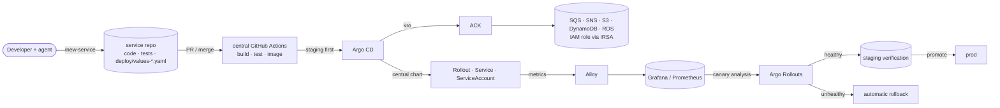
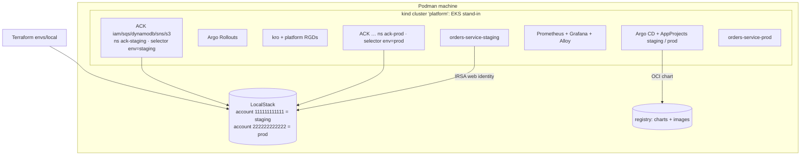

# Developer platform: design and local vertical slice

A design for an **agentic-first developer platform** that takes a team from "we need a new
service" to "running in production" in under a day, plus a **runnable vertical slice** of
it on your laptop. kind stands in for EKS and LocalStack for AWS.

- **Developers** pick a language preset, tell their agent what the service needs, write
  business logic and tests, and merge. Build, test, image, deploy, cloud resources, IAM
  and health-gated promotion are built in.
- **The platform team** owns one Helm chart (with a strict, documented values schema), one
  set of central GitHub Actions, kro definitions over ACK controllers, and the
  Terraform-built VPC and EKS prerequisite.
- **Agents** find their way through `CLAUDE.md` breadcrumbs and do each journey through
  skills (`/new-service`, `/promote-service`, `/decommission-service`, `/update-chart`).

> Full architecture, diagrams and decisions: [docs/design.md](docs/design.md) ·
> [journeys](docs/journeys/) · [ADRs](docs/adr/) · [chart reference](platform/charts/microservice/README.md)



## The three journeys

| Journey | What the developer does | What the platform does |
|---|---|---|
| **1. New service** | `/new-service` → answers questions (language, queues, tables, exposure…), writes logic, merges | Scaffolds the repo from a preset; writes and validates `deploy/values-*.yaml`; on merge creates the AWS resources, a least-privilege IRSA role and the workload in **staging**, verifies it with metrics, then promotes the same image to **prod** |
| **2. Update a service** | Changes code and/or values (e.g. "add an SNS topic"), merges | New release goes canary → Prometheus analysis → promote, in staging then prod; an unhealthy canary is aborted and **rolled back automatically** |
| **3. Decommission** | `/decommission-service` or the `decommission` workflow | Removes the service from staging, then prod; queues, roles and policies are deleted; tables, buckets and DBs are **retained**, and tables and DBs have AWS **deletion protection** on, unless explicitly released |

Prod is reachable **only** through promotion, and promotion requires a staging
verification record for the exact image tag. Details:
[delivery pipeline](docs/design.md#delivery-pipeline).

## Using the platform: a developer's guide

What you need: Claude Code, access to the GitHub org, and this platform repo cloned (it
carries the skills). You never need the AWS console, `kubectl`, Helm, or a pipeline file.

### 1. Create a new service

1. Open Claude Code in the platform repo and type `/new-service`.
2. Describe the service in a sentence or two, the way you would to a colleague. For
   example: "A Python service that reads orders from a queue and saves them so we can
   look them up by order ID."
3. Answer the follow-up questions. The agent asks for:
   - a name, your team, and the language;
   - what the service receives, sends and stores;
   - whether other services call it over HTTP;
   - whether its data should be kept if the service is ever retired.
   If you're unsure, the agent suggests a sensible default.
4. Read the summary the agent gives you: what will be created for your service, and the
   environment variable names your code uses to find each one (for example
   `SQS_ORDERS_QUEUE_NAME`). Say yes to create the repository. The agent asks again
   before publishing it to GitHub.
5. Open the new repo. Write your logic where the template marks it, and fill in the test
   stubs (they are marked `TODO`). Read your queue, table or bucket names from the
   environment variables from step 4.
6. Run the tests. The commands are in the repo's `CLAUDE.md`, or ask your agent to run
   them.
7. Push a branch and open a pull request. Wait for the checks to go green and get a
   review.
8. Merge. That is the deploy: the service goes to staging first and, if it is healthy
   there, on to production. If your team requires approval for production, approve the
   waiting "prod" step in the Actions run.
9. Check that it's live: the Actions run shows staging and prod green, and your service
   appears on the "Platform / Service health" dashboard.

### 2. Change a service

- **Code changes**: branch, change the code and tests, open a pull request, and merge.
  Merging ships it to staging and then production, exactly as in steps 7–9 above.
- **A new queue, table, bucket, topic, database, or more capacity**: tell your agent
  what you need, for example "this service now also publishes an `order-shipped` event"
  or "run 4 copies in production". It updates your deploy settings and checks them.
  Review that change in the pull request alongside your code, then merge. Your code reads
  the new resource from the environment variable the agent names.
- **If a release goes wrong**: you don't need to do anything to undo it. An unhealthy
  release is rolled back automatically, and the Actions run turns red and says which
  health check failed. Fix the problem and merge again.
- **If production didn't update, or you want to ship to production by hand**: type
  `/promote-service`. The agent tells you whether that version passed staging and, if so,
  promotes it after you confirm.

### 3. Retire a service

1. Type `/decommission-service` and name the service. The agent lists everything the
   service owns.
2. Answer its questions: does anything still depend on this service, and for each place
   it stores data, should that data be **kept** (the default) or **deleted**?
3. In the service's GitHub repo, open **Actions → decommission → Run workflow**. Type the
   service name to confirm, and tick "delete data" only if you chose to delete it in
   step 2.
4. The service is removed from staging first. Approve the production step when it asks.
5. Archive the repository. If you kept any data, the run lists it; your team decides
   later whether to export or delete it.

### Trying the journeys in this demo repo

Locally, the `make` targets play the role of merging and of the GitHub buttons:

| You would… | Locally |
|---|---|
| merge to deploy to staging | `make deploy-staging` |
| watch production get promoted | `make promote` |
| see a bad release roll back | `make break-and-rollback` |
| run the decommission workflow | `make decommission` |
| all of it, in order | `make demo` |

## Migrating existing services

Teams already on Kubernetes, with Terraform-managed AWS resources and bespoke CI, move
onto the platform without losing any data store. Data stores and queues are **adopted in
place**, never recreated. The sequence for each one:
1. back it up and turn on protection;
2. let ACK observe it read-only until the declared config matches reality;
3. have Terraform forget it (`removed`, `destroy = false`);
4. only then let ACK manage it;
5. cut the workload over, staging then prod, with the old deployment kept as an instant
   rollback.

Full plan, including the platform features migrations still need (adopt-existing mode,
read-only adoption, a diff gate), per-service phases, data-safety invariants and the wave
plan: **[docs/migration.md](docs/migration.md)**.

## Repository map

This is one repo for the demo; each top-level area stands in for a separate repository.

| Path | Stands in for | Contents |
|---|---|---|
| [`infra/terraform`](infra/terraform) | `platform-infra` | **Prerequisite**: VPC, EKS (+IRSA), platform IAM (permissions boundary, ACK roles, deploy role); `envs/local` applies it to LocalStack |
| [`platform/bootstrap`](platform/bootstrap) | `platform-bootstrap` | Cluster add-ons: kro + RGDs, ACK, Argo CD (+projects), Argo Rollouts, Prometheus/Grafana, Grafana Alloy |
| [`platform/charts/microservice`](platform/charts/microservice) | `platform-charts` | The central chart, `values.schema.json`, helm-unittest suites |
| [`platform/workflows`](platform/workflows) | `platform-workflows` | Reusable workflows + `scripts/platform_deploy.py` (the deploy CLI) |
| [`templates/`](templates) | template repos | Presets: `python-fastapi`, `go-http`, `java-springboot` |
| [`scaffold/`](scaffold) | scaffolder | `new_service.py`: repo from a preset |
| [`examples/orders-service`](examples/orders-service) | a service repo | **The vertical slice**: SQS → Python → DynamoDB |
| [`local/`](local) | dev tooling | kind/LocalStack/registry bring-up, tool installer, traffic helper |
| [`.claude/skills/`](.claude/skills) | agent skills | `new-service`, `promote-service`, `decommission-service`, `update-chart` |
| [`docs/`](docs) | docs | design, journeys, ADRs |
| [`tests/`](tests) | — | IAM least-privilege proof, deploy-CLI, scaffold and cookbook tests |

## Quickstart: run the vertical slice locally

### Prerequisites

| Need | Notes |
|---|---|
| Container runtime | Podman (tested 5.8, rootful machine with **4 CPU / 8 GiB**: `podman machine set --cpus 4 --memory 8192 --rootful`) or Docker. With Docker, set `KIND_EXPERIMENTAL_PROVIDER=docker` and replace `podman` in the Makefile |
| Terraform ≥ 1.6 | `terraform` on PATH |
| Python ≥ 3.10, git, curl | for the tooling and the example service |
| Go 1.25+, JDK 17+ | only to build or test the Go/Java presets |

Everything else (kind, Helm 3.22, kubectl, kubeconform, actionlint, helm-unittest, Python
deps) is installed **inside the repo** by `make tools`, with checksums verified. The
session uses its own kubeconfig (`.tools/kubeconfig`), so your real clusters are never
touched.

### Run it

```bash
make tools     # repo-local CLIs + .venv
make test      # static checks: no cluster needed (about 1 minute)
make up        # kind + LocalStack + registry → Terraform prerequisite → platform add-ons → publish chart (about 15 minutes the first time)
make demo      # journeys 1–3 end to end (about 10 minutes)
make down      # remove everything
```

UIs while it runs:
- Argo CD: http://localhost:8080 (user `admin`; password from
  `kubectl -n argocd get secret argocd-initial-admin-secret -o jsonpath='{.data.password}' | base64 -d`)
- Grafana: http://localhost:3000 (`admin`/`admin`; dashboard *Platform / Service health*)
- Prometheus: http://localhost:9090

### What `make up` builds (and why it is shaped like production)



1. `make cluster` runs `local/up.sh`: kind, LocalStack 4.14 and an OCI registry on one
   container network, plus a CoreDNS rewrite so pods resolve `localstack` (including
   S3's virtual-hosted `<bucket>.s3.localstack`).
2. `make infra` applies `infra/terraform/envs/local`: **the same `vpc` and `platform-iam`
   modules as AWS**, applied to two LocalStack accounts:
   - a VPC and subnets;
   - an IAM OIDC provider for the kind issuer (the EKS module creates this on AWS);
   - the workload permissions boundary and the ACK controller roles;
   - SSM chart globals, plus `local/generated/<env>-globals.yaml`.
3. `make bootstrap` runs `platform/bootstrap/install.sh`: kro (with the 6 RGDs), ACK
   controllers per environment, Prometheus + Grafana + Alloy, Argo Rollouts and Argo CD
   (with a health check for kro kinds, AppProjects and the chart repo).
4. `make publish-chart` pushes `microservice` 0.1.0 to the local registry, which is where
   Argo CD pulls it from.

### Walkthrough: the orders-service slice

`examples/orders-service` is a FastAPI service that long-polls SQS, validates and prices
each order, and writes it to DynamoDB. Its whole deploy intent is
[`deploy/values-staging.yaml`](examples/orders-service/deploy/values-staging.yaml):

```yaml
aws:
  sqs:
    - {name: orders, access: consume}
  dynamodb:
    - {name: orders, access: readwrite, partitionKey: {name: orderId, type: string}, deletionPolicy: retain}
```

**Journey 1: deploy to staging** (`make deploy-staging`). The deploy CLI validates the
values, applies the Argo CD Application, and gates on the release. Observed:

```
[platform] deploying orders-service:6dbf495 to staging as release local-20261119013400 (chart microservice 0.1.0)
[platform] argo sync=Synced health=Progressing | rollout phase=Progressing step=0/3
[platform] argo sync=Synced health=Suspended | rollout phase=Paused step=1/3 CanaryPauseStep
[platform] argo sync=Synced health=Healthy | rollout phase=Healthy step=3/3
[platform] orders-service:6dbf495 is healthy in staging
[platform] recorded staging verification /platform/promotions/orders-service/6dbf495
```

The pods run as their IRSA role in the staging account:

```
running as arn:aws:sts::111111111111:assumed-role/orders-service-staging/botocore-session-… (account 111111111111)
resolved queue=http://sqs.us-east-1.localstack:4566/111111111111/orders-service-orders table=orders-service-orders
```

`make verify` sends 20 orders and reads them back from DynamoDB:

```
20 orders in orders-service-orders (staging); processed by version: {'6dbf495': 20}
latest: {"totalCents": "1200", "orderId": "c64dde-0019", "status": "RECEIVED", "processedBy": "6dbf495", …}
```

`make iam` shows the role: trust pinned to the ServiceAccount, the boundary attached, and
exactly two scoped policies:

```
role arn:aws:iam::111111111111:role/orders-service-staging
  boundary: arn:aws:iam::111111111111:policy/platform-workload-boundary
  trust:    {"StringEquals": {"…:sub": "system:serviceaccount:orders-service-staging:orders-service", "…:aud": "sts.amazonaws.com"}}
  orders-service-dynamodb-orders: [GetItem, BatchGetItem, Query, Scan, DescribeTable, PutItem, UpdateItem, DeleteItem, BatchWriteItem] on [table/orders-service-orders, table/orders-service-orders/index/*]
  orders-service-sqs-orders: [ReceiveMessage, DeleteMessage, ChangeMessageVisibility, GetQueueAttributes, GetQueueUrl] on arn:aws:sqs:us-east-1:111111111111:orders-service-orders
```

**Journey 2: update and automatic rollback.** `make update` redeploys under live
traffic. The AnalysisRun measured `canary-up=1` and `work-failure-ratio=0` four times and
the canary was promoted. `make break-and-rollback` deploys the same image with a
`FAIL_RATE=1` overlay:

```
rollout phase=Degraded RolloutAborted: … Metric "work-failure-ratio" assessed Failed due to failed (2) > failureLimit (1)
RELEASE FAILED: analysis orders-service-7d79d77ff5-3-2: work-failure-ratio=Failed (last value [1])
rolling back orders-service in staging to last good release local-20261119013400 (6dbf495)
rollback complete; orders-service runs 6dbf495
```

No staging verification is written for the failed release.

**Promotion.** `make promote` with an unverified tag is refused; with the verified one it
deploys prod, which runs in account 222222222222:

```
ERROR: orders-service:deadbee has no staging verification (/platform/promotions/orders-service/deadbee). Deploy it to staging …
ERROR: prod deploys go through `promote` (requires a staging verification)          # direct `deploy --env prod`
staging verification found: verified 2026-11-19T01:35:31Z with chart 0.1.0
orders-service:6dbf495 is healthy in prod
running as arn:aws:sts::222222222222:assumed-role/orders-service-prod/…
```

**Journey 3: decommission** (`make decommission`). Prod is refused while staging still
exists. Staging is removed: queue, policies and role deleted; the table retained and
reported:

```
ERROR: decommission orders-service from staging first (its Application still exists)
deleting Application orders-service-staging (cascades to every resource it created)
RETAINED in AWS (deletionPolicy=retain), delete or archive deliberately: dynamodb/orders
orders-service decommissioned from staging
```

## How it works

### Prerequisite: VPC and EKS (Terraform, `infra/terraform`)

Services never create networks or clusters. Each environment is a separate AWS account
with one VPC and one EKS cluster, built by the platform team:

```
infra/terraform/
├── modules/vpc            # public/private subnets per AZ, NAT, LB discovery tags, DB subnet group
├── modules/eks            # cluster, managed nodes, IRSA OIDC provider, access entries
├── modules/platform-iam   # workload permissions boundary · ACK controller IRSA roles · GitHub deploy role
├── modules/environment    # vpc → eks → platform-iam; publishes chart globals to SSM
└── envs/{staging,prod}    # real roots (S3 backend, allowed_account_ids)
    envs/local             # same modules on LocalStack (kind replaces EKS)
```

```bash
terraform -chdir=infra/terraform/envs/staging init && terraform -chdir=infra/terraform/envs/staging apply   # real AWS
make infra                                                                                                    # LocalStack
```

Outputs (account, OIDC provider ARN/issuer, VPC, DB subnet group, node SG, boundary ARN)
are written to SSM `/platform/<env>/chart-globals`. The deploy pipeline injects them as
the chart's `global` values, so service values never contain environment facts.

### The central chart (`platform/charts/microservice`)

- **Contract**: [`values.schema.json`](platform/charts/microservice/values.schema.json),
  strict and described, with the generated reference in the
  [chart README](platform/charts/microservice/README.md). `platform_deploy.py validate`
  checks a values file against it before any deploy (in the PR via `validate-deploy.yaml`),
  plus platform rules:
  - `global` is pipeline-only;
  - the health endpoints and `metrics.path` must be declared;
  - no reserved env vars and no `latest`.
- **Renders**:
  - a Rollout backed by a zero-replica Deployment template, plus an AnalysisTemplate;
  - Service, ServiceAccount (IRSA), HPA/PDB, and optional ALB/NLB;
  - kro instances for `aws.sqs|sns|s3|dynamodb|rds` (sync wave -2), then
    `PlatformWorkloadIdentity` (wave -1), then the workload (wave 0).
- **kro RGDs** (`platform/bootstrap/rgds`) expand each instance into ACK resources plus an
  IAM policy whose Resource is wired from the created resource's real ARN, and a role
  whose trust is pinned to the service's ServiceAccount and carries the permissions
  boundary. ACK reconciles them against AWS.
- **Tests**: 26 helm-unittest cases (`platform/charts/microservice/tests`), kubeconform,
  and the static IAM proof (`tests/test_iam_least_privilege.py`).

### Central GitHub Actions (`platform/workflows`)

A service repo carries three thin callers (shipped by every preset):

```yaml
# .github/workflows/deploy.yaml in a service repo (abridged)
jobs:
  build:   {uses: example-org/platform-workflows/.github/workflows/build-python.yaml@v1, with: {push-image: true}}
  staging: {needs: build, uses: example-org/platform-workflows/.github/workflows/deploy.yaml@v1,
            with: {image-tag: "${{ needs.build.outputs.image-tag }}"}}
  prod:    {needs: [build, staging], uses: example-org/platform-workflows/.github/workflows/promote.yaml@v1,
            with: {image-tag: "${{ needs.build.outputs.image-tag }}"}}
```

- `build-{python,go,java}`: lint, unit, integration against a LocalStack service
  container, the deploy-contract check (validate + render + kubeconform, both
  environments), then the image (ECR, immutable SHA tag, SBOM + provenance).
- `deploy` (**staging only**), `promote` (`check-verified` with staging credentials, then
  prod in the `production` environment), and `decommission` (staging, then prod).
- All logic lives in `scripts/platform_deploy.py`, which the `Makefile` runs locally. The
  `setup-platform` composite action installs it from the same ref as the workflow.

To adopt in a GitHub org:
1. Set the org OIDC subject template to include `job_workflow_ref`. The deploy roles trust
   only the platform's reusable workflows, so a service repo's own job cannot reach prod
   or forge the staging ledger.
2. Create the GitHub environments `staging` and `production`
(add reviewers on production), each with variables `PLATFORM_DEPLOY_ROLE_ARN` (Terraform
output `deploy_role_arn`), `PLATFORM_CLUSTER_NAME`, `PLATFORM_AWS_REGION` and
`PLATFORM_ARGO_CHART_REPO`; set an org variable `PLATFORM_BUILD_ROLE_ARN` (ECR push);
publish the chart to `ghcr.io/example-org/charts`; and tag `platform-workflows` with `v1`.

### Health validation and rollback

- **Probes**: liveness `/healthz` (never checks dependencies) and readiness `/readyz`
  (dependencies reachable), declared in values and required by validation.
- **Metrics contract**: `http_requests_total{method,path,status}`,
  `app_work_items_total{outcome=success|failure|rejected}`, `app_work_duration_seconds`.
  Alloy scrapes annotated pods and remote-writes them (Grafana Cloud in production; the
  local Prometheus here).
- **Verification**: a release counts as verified only when a Successful AnalysisRun judged
  its exact pod hash. First revisions, where Rollouts skips the canary, get a verification
  analysis run by the CLI.
- **Gate**: each canary step runs an AnalysisRun against the canary pods only
  (`canary-up`, `http-error-ratio`, `work-failure-ratio`; per-service thresholds). On
  failure Argo Rollouts aborts to the stable ReplicaSet. The deploy CLI then re-applies
  the last good Application (so Git, Argo and the cluster agree) and fails the job. Pods
  that never become Ready abort via `progressDeadlineAbort`.

## Agentic development

The repo is meant to be worked on through Claude Code, by developers and the platform
team alike.

### Steering: breadcrumbs, not a wall of context

```
CLAUDE.md                              ← router: area → guide, journeys → skills, the 4 contracts, rules
├── docs/CLAUDE.md
├── infra/terraform/CLAUDE.md
├── platform/bootstrap/CLAUDE.md       ← RGD authoring pitfalls, env → controller mapping
├── platform/charts/microservice/CLAUDE.md   ← schema-first change process, template map
├── platform/workflows/CLAUDE.md       ← workflow catalogue, deploy CLI behaviour
├── templates/CLAUDE.md                ← (platform team) preset requirements
│   └── <preset>/CLAUDE.md             ← ships INTO each service repo, written for its developers
├── scaffold/CLAUDE.md · local/CLAUDE.md · tests/CLAUDE.md
└── examples/orders-service/CLAUDE.md
```

The root file is short and only points the way. Claude Code loads a directory's
`CLAUDE.md` when it works in that directory, so an agent editing the chart gets the chart
rules, not the Terraform ones. Every scaffolded service gets its own `CLAUDE.md`
describing its contract (endpoints, metrics, env vars, how to change resources).

### Skills

| Skill | For | Highlights |
|---|---|---|
| [`/new-service`](.claude/skills/new-service/SKILL.md) | developers | Interviews in two rounds (identity; what it consumes/publishes/stores/exposes). Maps answers to values with a decision table, scaffolds, writes **both** values files, runs `validate` until green, renders a preview, then explains env vars and how it ships. Also has an update mode for adding resources. |
| [`/promote-service`](.claude/skills/promote-service/SKILL.md) | developers | Checks the staging verification, diffs prod/staging intent, confirms, promotes, explains failures |
| [`/decommission-service`](.claude/skills/decommission-service/SKILL.md) | developers | Inventory, an explicit data decision, then staging before prod; reports what was retained |
| [`/update-chart`](.claude/skills/update-chart/SKILL.md) | platform team | Schema-first chart/RGD changes with tests, a live RGD check and a version bump |

The skill's [values cookbook](.claude/skills/new-service/references/values-cookbook.md)
is **tested**: `tests/test_cookbook.py` validates every snippet against the chart, so an
agent can never be taught an invalid example. The chart README's values table is
generated from the schema and checked for drift.

Example session:

```
> /new-service
  I need a Go service that consumes payment events from a FIFO queue, writes a ledger row
  per event keyed by paymentId with a timestamp sort key, and publishes a "settled" event.
  Internal only.
  ← agent asks: service name? team? keep the ledger table on decommission?
  ← scaffolds payments-ledger (go-http), writes aws.sqs (consume, fifo), aws.dynamodb
     (partition paymentId, sort settledAt), aws.sns (publish), validates both files,
     and lists SQS_PAYMENTS_QUEUE_NAME, DYNAMODB_LEDGER_TABLE, SNS_SETTLED_TOPIC_ARN.
```

## Testing and verification

| Check | Command | Covers |
|---|---|---|
| Everything static | `make test` | all rows below except e2e |
| Repo tests (58) | `make test-python` | IAM least-privilege proof, deploy CLI, scaffold (all presets), cookbook, README drift |
| Chart | `make test-chart` | helm lint, 26 helm-unittest cases, kubeconform, example values |
| Terraform | `make test-terraform` | fmt + validate for staging, prod and local roots |
| Workflows | `make test-workflows` | actionlint across central, preset and repo workflows |
| Example service | `make test-example` | ruff, 12 unit tests (moto), LocalStack integration test |
| Presets | repo CI `presets` job | scaffold + build + unit + LocalStack integration for python, go (vet, race, staticcheck) and java (Spring Boot 4.1) |
| End to end | `make demo` | journeys 1–3 on kind + LocalStack (outputs above) |

This repo's own CI ([`.github/workflows/ci.yaml`](.github/workflows/ci.yaml)) runs the
static checks and the preset matrix. The e2e run needs about 8 GiB and is run locally.

## Known limitations of the local slice

- **IAM is not enforced** by LocalStack Community. Least privilege is shown by the static
  proof and by inspecting live policies (`make iam`), not by an access-denied test.
- **One cluster** hosts both environments locally (separate namespaces, AppProjects,
  ACK controller sets and LocalStack accounts). In AWS each environment is its own
  cluster and account.
- **RDS and ALB/NLB** are rendered and unit-tested but not run (no RDS in LocalStack
  Community; no load balancer controller).
- **`decommission --delete-data`** cannot finish locally: ACK's DynamoDB controller calls
  `GetResourcePolicy`, which LocalStack Community does not implement. The CLI reports the
  stuck Table. The default (retain) path works fully.
- **GitHub Actions are linted, not executed** here. The Makefile runs the same deploy CLI
  the workflows call.
- The deploy pipeline applies the Argo CD Application directly. A GitOps deploy repo (the
  pipeline commits the tag) is the documented next step.
- **Re-adopting retained data** (redeploying after a decommission) uses ACK
  `adopt-or-create`. It works on AWS but not locally, for the same `GetResourcePolicy`
  reason. `make demo` therefore starts with `make clean-retained`, which drops the
  LocalStack tables an earlier run retained.
- kro's `omit()` is an alpha feature (`CELOmitFunction` gate) in kro 0.10.

## Pinned versions

kro 0.10.0 · ACK iam 1.12.0, sqs 1.10.0, dynamodb 1.16.0, sns 1.14.0, s3 1.16.0, rds 1.15.1,
ec2 1.25.0 · Argo CD chart 10.18.1 (v3.6) · Argo Rollouts chart 2.43.12 (v1.10.2) ·
kube-prometheus-stack 93.4.1 · Alloy chart 1.16.0 (v1.22) · LocalStack 4.14.0 · kind 0.33.0 ·
Helm 3.22.1 · Terraform AWS provider ~> 6.0. See `platform/bootstrap/versions.env` and
`local/install-tools.sh`.
