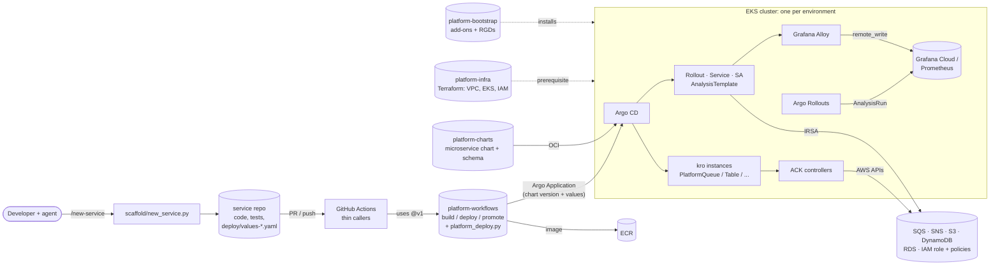
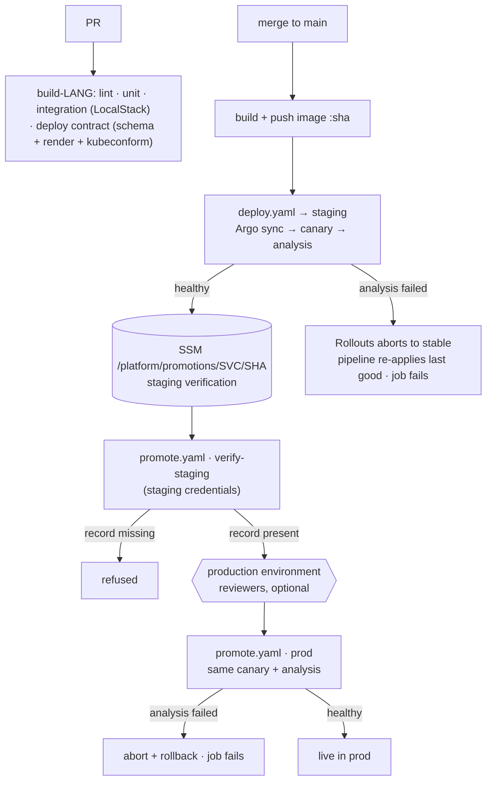
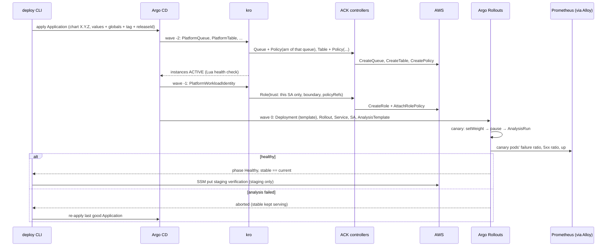
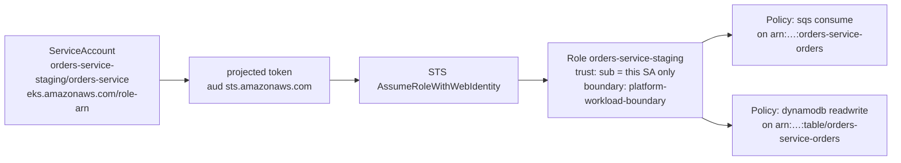

# Developer platform: design

## Goals

1. **Idea to production in under a day.** A developer picks a language, describes what
   the service needs, and ships. Build, test, deploy, cloud resources and IAM come with
   the repo.
2. **Safe by default.** Every release goes through staging, is judged by real health
   signals, and is rolled back automatically. Every service gets least-privilege IAM it
   cannot widen.
3. **Agentic first.** Every component has steering (`CLAUDE.md`) and every journey has a
   skill, so a developer's agent can do the work consistently and the platform team's
   agents can evolve the platform safely.
4. **One source of truth per concern.** One chart, one schema, one set of workflows, one
   deploy CLI. Service repos contain only the service.

## System overview

## Components and ownership

| Component | Repo (here: directory) | Owner | Changes when |
|---|---|---|---|
| VPC, EKS, IRSA OIDC, platform IAM, permissions boundary | `infra/terraform` | platform | new environment/region, capacity, boundary review |
| Cluster add-ons: kro, ACK, Argo CD/Rollouts, Alloy, RGDs | `platform/bootstrap` | platform | add-on upgrade, new resource type |
| `microservice` chart + `values.schema.json` | `platform/charts/microservice` | platform | new option (versioned, immutable releases) |
| Reusable workflows + deploy CLI | `platform/workflows` | platform | pipeline change (tagged `v1`) |
| Language presets | `templates/*` | platform | new language or dependency bumps |
| Service code, tests, `deploy/values-*.yaml` | each service repo (`examples/orders-service`) | service team | every feature |

The split keeps the developer's surface to a single file of intent. A service repo has no
Dockerfile logic to maintain beyond the preset's, no pipeline YAML beyond three
`uses:` lines, and no Helm templates.

## Why this shape

- **Central chart + schema, values in the service repo.** The schema is the API between
  developers and the platform. Because the chart is strict (`additionalProperties: false`),
  a typo fails in the PR, not in the cluster, and agents get a precise, machine-checkable
  target to write against.
- **kro composes, ACK provisions.** The chart renders high-level kinds (`PlatformQueue`).
  kro expands each into ACK resources and wires outputs (the queue's real ARN) into the
  IAM policy. The platform can change *how* a queue is built (encryption, tags, DLQs)
  without a chart release. See [ADR 0002](adr/0002-kro-composition-over-raw-ack.md).
- **Argo CD, not `helm upgrade`.** Desired state lives in an Argo CD Application; drift
  is reverted (`selfHeal`), and deletion cascades (decommission). The pipeline only
  changes the Application and then *watches*.
- **Argo Rollouts for the health gate.** Canary steps with Prometheus analysis on the
  canary pods' own metrics; abort is automatic and in-cluster, so a broken pipeline
  runner cannot leave a bad release half-rolled. See
  [ADR 0003](adr/0003-argo-rollouts-for-health-gated-delivery.md).

## Delivery pipeline

Enforcement points, from weakest to strongest:
1. The service's `deploy.yaml` orders the jobs: prod `needs` staging.
2. `promote.yaml` runs `check-verified` in a job that holds only staging credentials, and
   deploys only if the exact image tag has a staging record. The record is written by the
   deploy CLI only after the release gate passes (`wait_for_release`).
3. `platform_deploy.py deploy --env prod` refuses to run outside the promote pipeline.
4. The `production` GitHub environment holds the only role that can reach the prod
   cluster, and can require reviewers.
5. The deploy roles trust **only the platform's reusable workflows** at the released ref
   (`job_workflow_ref` in the GitHub OIDC subject). Prod trusts only `promote.yaml` and
   `decommission.yaml`. A job a service repo writes itself cannot get prod credentials,
   and cannot write the staging ledger.
6. A tag is recorded as verified only if a **Successful AnalysisRun judged its exact pod
   hash**. On a Rollout's first revision Argo Rollouts skips canary steps, so the CLI runs
   the same AnalysisTemplate as a verification analysis. Promotion also requires the chart
   version staging verified, and in CI a repo may only deploy the service it is named after.

## What one sync does

The sync waves matter. ACK cannot attach a policy that does not exist yet, and its
controller backs off for minutes after a failed reconcile. Creating the role only after
every policy is ready keeps a first deploy to about a minute.

## Identity: IRSA and least privilege

- **Trust** is pinned to one ServiceAccount in one namespace on one cluster's OIDC
  provider, with the `sts.amazonaws.com` audience.
- **Permissions** are only the per-resource policies of the service's own kro instances.
  Each access level maps to a fixed action set (`consume`, `publish`, `read`,
  `readwrite`, `connect`), and each Resource is wired from that resource's real ARN.
- **Boundary**: every role is created with `platform-workload-boundary` (data-plane
  actions only; IAM/STS/Organizations denied). The ACK IAM controller's own policy only
  allows `CreateRole` *with* that boundary and denies removing it. So a bug in an RGD, or
  a malicious values file, cannot mint an admin role.
- **Proof**: LocalStack Community does not enforce IAM, so
  `tests/test_iam_least_privilege.py` checks the RGD policy sources statically (exact
  action sets, own-resource only, everything inside the boundary). `make iam` prints the
  live role from LocalStack for inspection.

## Health and observability

- **Probes (required)**: the values schema plus `validate` require `probes.liveness.path`,
  `probes.readiness.path` and `metrics.path`, declared by the service. Liveness never
  checks dependencies; readiness does.
- **Metrics contract**: `http_requests_total{method,path,status}`,
  `app_work_items_total{outcome}` and `app_work_duration_seconds`. Every preset emits them.
- **Pipeline**: pods opt in with `prometheus.io/*` annotations. Grafana Alloy discovers
  them, adds `namespace`, `app`, `version`, `environment`, `team` and
  `rollouts_pod_template_hash`, and remote-writes to Grafana Cloud (locally: an
  in-cluster Prometheus with the remote-write receiver, plus Grafana and the
  "Platform / Service health" dashboard).
- **Analysis**: per canary step, three metrics evaluated on the canary hash only:
  `canary-up`, `http-error-ratio` (5xx ratio) and `work-failure-ratio`. The thresholds
  are per service (`rollout.analysis.*`). Zero traffic counts as healthy; a missing
  metrics endpoint counts as unhealthy.

## Environments

| | staging | prod |
|---|---|---|
| AWS account | 111111111111 (example) | 222222222222 (example) |
| Cluster | `staging` EKS (Terraform `envs/staging`) | `prod` EKS (`envs/prod`) |
| Argo CD project | `staging`: `*-staging` namespaces only | `prod`: `*-prod` namespaces only |
| Reached by | `deploy.yaml` (GitHub env `staging`) | `promote.yaml` (GitHub env `production`) |
| Canary (preset default) | `[50]`, 20 s pause | `[34, 67]`, 30 s pause, 3 replicas |
| Data stores | retained on decommission + AWS deletion protection (tables, DBs) by default | same; RDS adds Multi-AZ + 14-day backups |

Per-environment facts (account, OIDC provider, VPC, boundary ARN) are Terraform outputs
published to SSM `/platform/<env>/chart-globals`. The pipeline injects them as `global`,
so the same values file never hard-codes an account.

## Local fidelity: what the slice runs and what it stands in for

| Real platform | Local slice | Fidelity |
|---|---|---|
| EKS per environment | one **kind** cluster; namespaces `<svc>-staging` / `<svc>-prod` | Same Argo CD projects and namespaces; one cluster instead of two |
| AWS accounts | **LocalStack** accounts 111111111111 / 222222222222 | Real API calls; IAM **not enforced** (Community) |
| ACK controllers with IRSA | ACK per environment with fake keys selecting the account, `watchSelectors` on the env label | Same CRDs, same RGDs, same reconcile paths |
| Pod-identity webhook (IRSA) | chart injects `AWS_ROLE_ARN` + projected token (`global.local`) | Identical SDK path: `AssumeRoleWithWebIdentity` against STS |
| ECR | OCI registry container `kind-registry` | |
| Grafana Cloud | Prometheus (remote-write receiver) + Grafana in-cluster | Alloy config is the same; only the URL differs |
| GitHub Actions | `make` targets calling the **same** `platform_deploy.py` | Workflows are linted (actionlint), not executed |
| RDS, ALB/NLB | rendered and unit-tested only | LocalStack Community has no RDS; there is no LB controller |

Verified end to end locally:
- new service → staging, with resources and IRSA identity;
- SQS → pod → DynamoDB;
- canary + analysis on live traffic;
- a faulty release aborted and rolled back;
- promotion refused without a staging record, then succeeding with one;
- decommission retaining the table.

Known gaps are listed in the README.

## Security notes

- No static cloud credentials anywhere: GitHub OIDC for CI, IRSA for pods and controllers.
- AppProjects whitelist exactly the kinds the chart renders. A service cannot create raw
  ACK resources, RBAC or cluster-scoped objects other than its own Namespace.
- Values files cannot set `global`, reserved env-var prefixes or `latest` tags.
- Workflow inputs are passed to scripts through `env:` (no `${{ }}` in `run:`), and
  downloaded tools are checksum-verified.
- Deploy roles are assumable only from `example-org/platform-workflows` reusable workflows
  at `refs/tags/v1`, in the matching GitHub environment. This needs the org's OIDC subject
  template to include `job_workflow_ref` (`gh api -X PUT orgs/<org>/actions/oidc/customization/sub ...`;
  see `modules/platform-iam`). Only the staging role may write the promotion ledger.
- ECR repositories are created with immutable tags, so a verified tag cannot be re-pushed.
- The deploy role has cluster-admin through an EKS access entry for simplicity. Hardening
  step: scope it to `applications.argoproj.io` in `argocd` plus read access in service
  namespaces.

## Not in this slice (next steps)

- The proposed guardrails and features roadmap: [next-steps.md](next-steps.md).

- Migrating existing services (adopt-in-place, read-only diff gate, Terraform release):
  see [migration.md](migration.md); the chart features it needs are listed there.

- GitOps deploy repo (the pipeline commits the tag; Argo pulls) instead of the pipeline
  applying the Application. `build_application` already isolates that choice.
- DLQs and alarms in `PlatformQueue`; KMS CMKs per service.
- Backstage-style catalog/portal on top of the scaffolder and skills.
- Distributing the skills as a Claude Code plugin so service repos get them without
  cloning the platform repo.
- Cost and ownership tags enforced by policy (Kyverno/Gatekeeper) in addition to the RGD
  tags.
