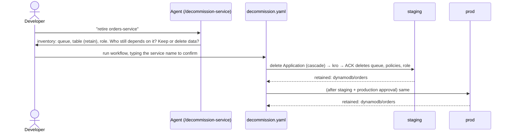

# Journey 3: decommissioning a service

- Deleting the Argo CD Application cascades (finalizer) to every object it created. kro
  deletes ACK resources, and ACK deletes the AWS resources, **except** data stores
  annotated `services.k8s.aws/deletion-policy: retain` (the default for DynamoDB, S3 and
  RDS). Those are reported for an explicit decision.
- `--delete-data` flips retained stores to `delete` first. Use it only after export or
  when the data is disposable.
- Staging verification records are kept as an audit trail.
- Locally: `make decommission`. With `--delete-data`, LocalStack Community cannot
  complete the DynamoDB deletion (see README known limitations).
