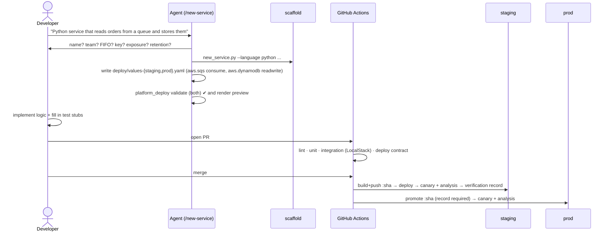

# Journey 1: a brand-new service

**Outcome:** a repo with working code, tests and pipeline, plus resources and IAM in
staging, then prod. Target: under a day, most of it spent on the actual logic.

## Steps and commands

| Step | Agent / developer does | Locally |
|---|---|---|
| Describe | `/new-service` interview | n/a |
| Scaffold | `scaffold/new_service.py --name … --language …` | same |
| Declare resources | skill writes the `aws:` block and validates it | `platform_deploy.py validate --values …` |
| Build + test | central `build-<lang>.yaml` on the PR | preset's own test commands |
| Staging | `deploy.yaml` on merge | `make deploy-staging SERVICE_DIR=…` |
| Exercise | n/a | `make verify` (orders-service) |
| Prod | `promote.yaml`, after staging | `make promote` |

What gets created on the first staging sync (orders-service): namespace
`orders-service-staging`; `PlatformQueue` → SQS `orders-service-orders` + consume policy;
`PlatformTable` → DynamoDB `orders-service-orders` + readwrite policy;
`PlatformWorkloadIdentity` → IAM role `orders-service-staging` (boundary attached); then
the Rollout, Service, ServiceAccount (IRSA) and AnalysisTemplate.
