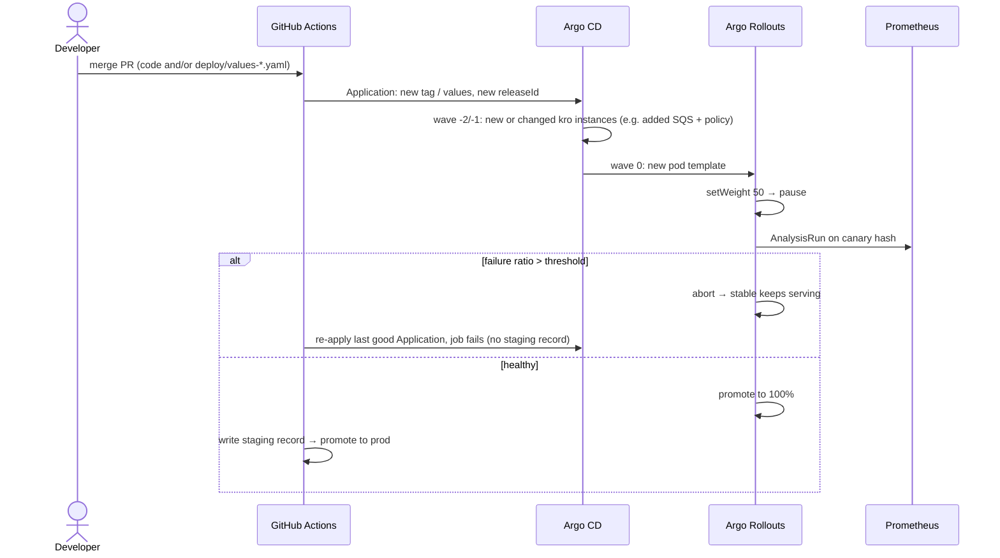

# Journey 2: updating a service

Two kinds of update, same path: **code** (new image) and **intent** (values: replicas,
thresholds, a new queue). Both are one PR. Merging deploys to staging with a canary, and
prod follows only if staging passed.



## Adding a resource

Ask the agent "add a topic `order-events` that this service publishes to". `/new-service`
in update mode adds `aws.sns: [{name: order-events, access: publish}]` to both values
files and validates them. On sync, kro creates the topic and a publish policy scoped to it,
and the existing role gets the new policy attached. The pod receives
`SNS_ORDER_EVENTS_TOPIC_ARN`.

## Proving the rollback locally

```bash
make update               # canary under live traffic: passes, records staging verification
make break-and-rollback   # FAIL_RATE=1 overlay: work-failure-ratio = 1 → aborted → rolled back
```

Observed output (abridged):

```
rollout phase=Paused step=1/3 CanaryPauseStep
rollout phase=Degraded RolloutAborted: Metric "work-failure-ratio" assessed Failed due to failed (2) > failureLimit (1)
RELEASE FAILED: analysis ...: work-failure-ratio=Failed (last value [1])
rolling back orders-service in staging to last good release local-... (6dbf495)
rollback complete; orders-service runs 6dbf495
```
