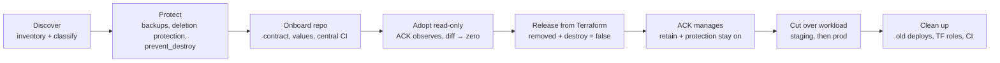

# Migrating existing services onto the platform

**Starting point:** every service already runs on Kubernetes. Its AWS resources are
managed by Terraform (in a mix of team-owned states and layouts), and it builds and
deploys through non-standard CI (Jenkins jobs, bespoke GitHub Actions, scripts).

**Goal:** each service ends up as a normal platform service:
- the central chart, values in its repo, central workflows;
- its AWS resources owned by kro/ACK and its IAM by the platform.

**Constraint:** we can move fast, but **no data store may be lost**. Not a table, a
bucket, a database, or the messages sitting in a queue.

## The safety model in one paragraph

Data stores are **never recreated**: they are *adopted in place*, by their existing
physical name. The order is fixed:
1. Protect and back them up first.
2. Let ACK *observe* them (read-only) until the declared config matches reality exactly.
3. Have Terraform *forget* them, without destroying them.
4. Only then let ACK *manage* them.

At no point do two tools own the same resource, and at no point can any tool delete one:
`deletionPolicy: retain`, AWS deletion protection and Terraform `destroy = false` are all
in force throughout.



## Phase 0: platform readiness (once, before the first service)

These are platform features the current slice does **not** have yet. Migrations depend on
them.

| # | Capability | Why | Size |
|---|---|---|---|
| 0.1 | **Adopt-existing mode in the chart**: `aws.<kind>[].existing: {name: <physical name>}` | Existing resources do not follow the `<service>-<name>` naming convention. In adopt mode the chart uses the given name, forces `deletionPolicy: retain` and `deletionProtection: true`, and sets ACK `adoption-policy: adopt` (attach only, never create) instead of `adopt-or-create`. Also allows `replicas: 0`, so resources can be adopted before the workload runs | chart + RGD fields, unit tests |
| 0.2 | **Read-only adoption switch**: `existing.readOnly: true` maps to the ACK annotation `services.k8s.aws/read-only: "true"` (the `ReadOnlyResources` gate is on by default) | ACK reconciles adopted resources *to the spec*. A spec missing a GSI, a lifecycle rule or a parameter would change or remove it. Read-only lets us see and diff first | RGD annotation, unit tests |
| 0.3 | **Full-fidelity data-store fields** (GSIs, TTL, PITR, streams, SSE/KMS, S3 lifecycle/CORS/replication, RDS parameter groups/storage) | The adopted spec must describe the real resource completely before ACK may manage it | per-kind RGD + schema work, the largest item |
| 0.4 | **Migration inventory tool**: `migrate/inventory.py <tf-state> <namespace>` | Reads Terraform state, AWS `Describe*` calls and the live Kubernetes objects; drafts `deploy/values-*.yaml` with `existing:` entries and a resource classification report | script + tests |
| 0.5 | **Adoption diff check**: `platform_deploy.py adopt-diff` | For each read-only ACK object, compares the observed state (from `status` / `ackResourceMetadata`) with the declared spec. Exit 0 only on zero diff. This gate unlocks managed mode | CLI subcommand |
| 0.6 | **Cross-account reach**, if stores live in team accounts rather than the platform's staging/prod accounts | Data cannot be moved between accounts without a copy. Adopt it where it is via ACK cross-account roles (CARM / `IAMRoleSelector`), and treat moving accounts as a later, separate copy project | ACK config + Terraform roles |
| 0.7 | **`/migrate-service` skill** | Runs phases 1–6 for a team with the same checklists, so migrations are consistent and parallelisable across agents | skill + references |

## Phase 1: discover (per service, about half a day)

1. **Inventory the workload** in each cluster/namespace: Deployments/StatefulSets,
   Services, Ingresses, HPAs, ConfigMaps/Secrets, ServiceAccounts (IRSA annotations),
   CronJobs, PVCs.
2. **Inventory the AWS side**: every Terraform resource in the service's state (and any
   shared state that references it), plus anything created by hand (`aws resourcegroupstaggingapi`
   by service tag, IAM roles trusted by its ServiceAccount).
3. **Map the traffic**: who produces to its queues and topics, who calls it over HTTP
   (DNS/Ingress hosts), and who reads its tables or buckets. Other teams' consumers must
   keep working throughout.
4. **Classify every resource**:

   | Class | Examples | Migration treatment |
   |---|---|---|
   | **Data store** | DynamoDB, S3, RDS | Adopt in place by name. Never recreated |
   | **Stateful messaging** | SQS (may hold messages), SNS (has subscriptions) | Adopt in place. Recreating loses messages or subscriptions and changes ARNs other teams use |
   | **Replaceable** | IAM roles/policies, security groups for the app, Ingress/LB | Platform creates new ones; old ones removed after cutover |
   | **In-cluster state** | PVC-backed databases, StatefulSets | **Out of scope** for the chart. Leave in place, or migrate to a managed store as a separate project (dump/restore, DMS) |
   | **Unsupported by the chart** | ElastiCache, OpenSearch, Kinesis… | Stay in Terraform for now; the service consumes them via `env`. Track as chart backlog |

5. **Gap-check the app against the platform contract**:
   - `/healthz`, `/readyz` and `/metrics` with the metric names;
   - runs as non-root with a read-only root filesystem;
   - listens on one HTTP port;
   - takes its AWS resource names from the platform env vars (`SQS_<NAME>_QUEUE_NAME`, …)
     rather than its own config.

## Phase 2: protect the data (before any ownership changes)

Nothing in later phases may run until every item here is done and recorded in the
migration PR:

1. **Backups you have restored from**: an on-demand AWS Backup of every DynamoDB table,
   RDS instance and S3 bucket. Restore one copy to a scratch name and check it.
2. **AWS-side protection**:
   - DynamoDB: deletion protection on, plus point-in-time recovery;
   - RDS: deletion protection on, and automated backups;
   - S3: versioning on, and MFA delete where policy allows.
3. **Terraform-side protection**: add `lifecycle { prevent_destroy = true }` to every data
   store and messaging resource in the team's Terraform, and apply it. From now on any
   plan that would destroy one fails.
4. **Freeze** unrelated Terraform changes to those resources until phase 4 ends.

## Phase 3: onboard the repo (code side, can run in parallel with phase 2)

1. **Overlay the platform files** onto the existing repo (do not rescaffold):
   - the preset's `.github/workflows/{ci,deploy,decommission}.yaml`;
   - `CLAUDE.md`;
   - `deploy/values-{staging,prod}.yaml`, drafted by the inventory tool.
   Keep the team's Dockerfile if it meets the contract; otherwise take the preset's.
2. **Close contract gaps** found in phase 1. Typically:
   - add the health and metrics endpoints;
   - rename metrics to the contract names;
   - read AWS names from the platform env vars. During the transition the app may read
     the old variable when the platform one is absent.
3. **Switch CI**: the PR build moves to `ci.yaml` (central build + tests + contract
   check). Leave the old *deploy* pipeline in place but **disabled**; it is the rollback
   path until phase 6.
4. **Name the repo after the service** (or set `service.name` to match), so the CI
   ownership check passes.

## Phase 4: adopt the AWS resources

Run this in **staging first, then prod**, environment by environment.

1. **Declare existing resources** in the values file with `existing:` (phase 0.1),
   `readOnly: true`. Retain and protection are forced on. For example:
   ```yaml
   aws:
     dynamodb:
       - name: orders
         access: readwrite
         partitionKey: {name: orderId, type: string}
         existing: {name: legacy-orders-prod, readOnly: true}
   ```
2. **Deploy through the platform** (`deploy.yaml` / `make deploy-staging`). kro creates
   the ACK objects, and ACK attaches to the existing resources (`adopt`; it fails loudly
   if a name is wrong, and never creates). The workload is not cut over yet: keep
   `replicas: 0` in this step, or deploy to the new namespace with the canary paused.
3. **Diff until zero**: `platform_deploy.py adopt-diff --env staging`. For every
   difference, change the values (or extend the chart, phase 0.3) until the declared
   spec equals reality. Do not "fix" AWS to match the values.
4. **Release from Terraform without destroying.** In the team's Terraform, *replace*
   each adopted resource's `resource` block with a `removed` block:
   ```hcl
   removed {
     from = aws_dynamodb_table.orders
     lifecycle { destroy = false }
   }
   ```
   `terraform plan` must show `will no longer be managed by Terraform` and
   **`0 to destroy`**. Apply it. Do the same for the queues and topics being adopted.
   Leave IAM, SGs and anything else alone for now.
5. **Hand over to ACK**: remove `readOnly`, then deploy. Run `adopt-diff` again (still
   zero) and check that the ACK objects report `ACK.ResourceSynced=True`. `retain` and
   deletion protection stay on permanently. `existing:` stays in the values file, because
   it records the resource's real name.

## Phase 5: cut over the workload (staging, then prod)

1. Deploy normally (`replicas` back to the real count). The service gets its platform
   IRSA role, scoped to exactly the adopted resources. The old Deployment keeps running
   with its old role.
2. **Shift traffic**:
   - *Queue consumers*: both versions consume the same adopted queue (competing
     consumers). This is safe only if processing is idempotent; if it isn't, scale the
     old Deployment to 0 in the same change.
   - *HTTP services*: move the Ingress host or DNS weight to the new Service. Keep the
     old one routable for instant rollback.
3. **Watch**: the canary analysis and the "Platform / Service health" dashboard. Error
   and failure ratios should match the old version's baseline.
4. **Retire the old workload**: scale it to 0 and keep its manifests for a rollback
   window (for example one week of prod traffic).
5. Prod: repeat phases 4–5 with `promote`, using the staging-verified image.

Rollback at any point is "scale the old Deployment back up and move traffic back". The
data stores were adopted in place and never changed hands destructively, so no data
rollback is ever needed.

## Phase 6: clean up

1. Delete the old Deployment/namespace, its IAM role and policies (Terraform), and its
   app security groups.
2. Delete the old CI deploy pipeline and any long-lived AWS keys it used.
3. Once the `removed` blocks have been applied in every environment, delete them (the
   resources and their `prevent_destroy` are already gone from the code). Archive the
   service's old Terraform if nothing remains in it.
4. Record the migration: service catalog entry, owner, `existing:` names, and the backup
   IDs from phase 2.

## Data-safety invariants (checked at every step)

- [ ] No data store or queue is ever created fresh for a migrating service:
      `adoption-policy: adopt` only, by exact physical name.
- [ ] No Terraform plan with a non-zero destroy count touching a data store or queue is
      applied. `prevent_destroy` stays in force until `removed` lands.
- [ ] Only one owner at a time: read-only ACK while Terraform owns it; Terraform released
      before ACK manages it.
- [ ] `deletionPolicy: retain` + AWS deletion protection on every adopted store,
      permanently.
- [ ] Backups taken **and restore-tested** before phase 4, and again before the prod
      phase 4.
- [ ] `adopt-diff` is zero before leaving read-only mode.
- [ ] Any surprise means **stop**: leave everything read-only and escalate. Every
      intermediate state is safe to sit in.

## Running it across the organisation

- **Pilot** with 2–3 services that cover the classes (one stateless HTTP service, one
  queue consumer with a table, one with S3), and harden the tooling on them.
- **Waves**, ordered by risk:
  1. stateless services (no adoption needed);
  2. messaging-only services;
  3. DynamoDB/S3 services;
  4. RDS services, last.
  Teams in a wave work in parallel. The `/migrate-service` skill carries each one
  through the same checklists.
- **Pace**: after the pilot, plan roughly a day per service to reach staging cutover and
  another to prod, mostly waiting on rollback windows. That makes a few dozen services per
  wave realistic.
- **Exit criteria per service**:
  - no Terraform resources left for it except unsupported kinds (tracked);
  - no bespoke CI;
  - the platform contract met;
  - prod deploys only through `promote`.
